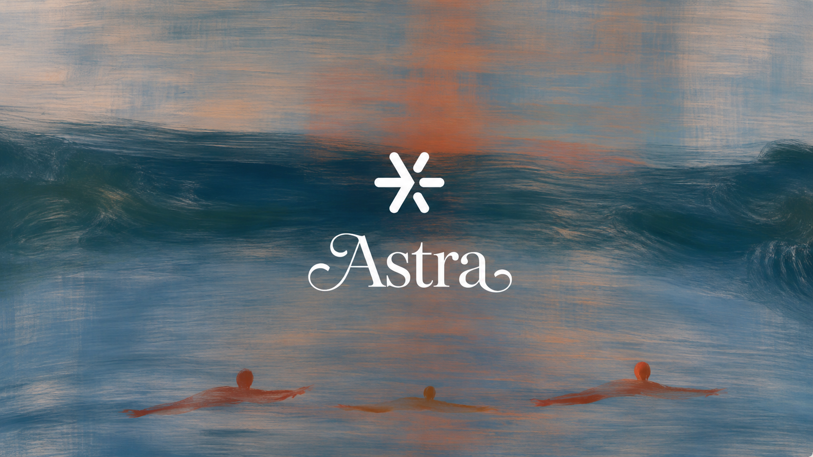

<p align="center">
  
</p>

<hr />

<p align="center"><strong>A fast, lightweight browser with a built in workspace for tasks, notes, focus and AI assisted work.</strong></p>

<p>
  <a href="LICENSE"></a>
  
</p>

<p align="center">
  
</p>

Astra is an open source desktop browser built with Rust, Tauri and Svelte. It uses the web engine provided by the operating system, with WebKit on macOS and WebView2 on Windows. Browser state, settings and workspaces are managed by Astra's Rust core.

## Browse

- Vertical tabs, spaces, profiles, pinned tabs, folders and split view
- Built in protection against ads and trackers
- Chrome extension support
- Import browsing data from supported browsers
- A new tab page, history, bookmarks and a keyboard driven launcher

## Work

Work gives AI assisted tasks a visual workspace alongside the browser. Astra includes tools for working with tasks, notes, focus sessions and connected services. You can choose supported AI providers and connect your own credentials.

## Privacy

- Browsing data and app settings are stored locally
- Private windows clear their session when closed
- Credentials are protected by the operating system's secure storage

## Build from source

### Requirements

- Rust via `rustup`
- Node.js 24.18 or newer in the 24.x series
- pnpm
- Tauri platform prerequisites

```sh
git clone https://github.com/Akshat-mohanty/Astra.git
cd Astra
pnpm install --frozen-lockfile
pnpm dev
```

On macOS, use `./scripts/build.sh` to build, sign and install the desktop app. The script stores compilation artifacts on the configured external build volume when it is mounted.

## Project structure

- `crates/` contains Astra's Rust application, browser, storage and work logic
- `desktop/` contains the Tauri desktop shell and native platform integrations
- `frame/` contains the Svelte interface
- `scripts/` contains build, run and maintenance scripts

## License

Astra is licensed under the Mozilla Public License 2.0. See [LICENSE](LICENSE). Bundled third party assets and filter lists may have additional licenses. See the notices included with the application.
